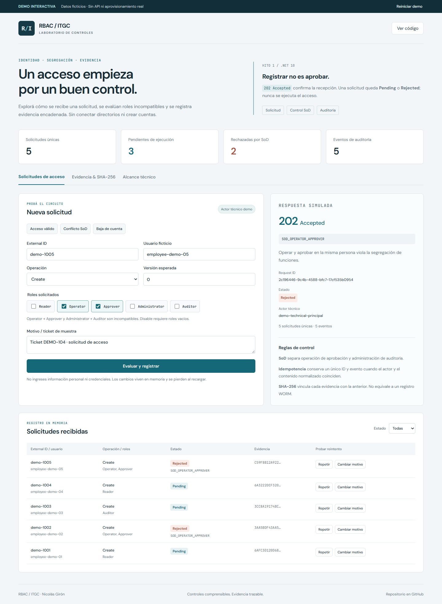
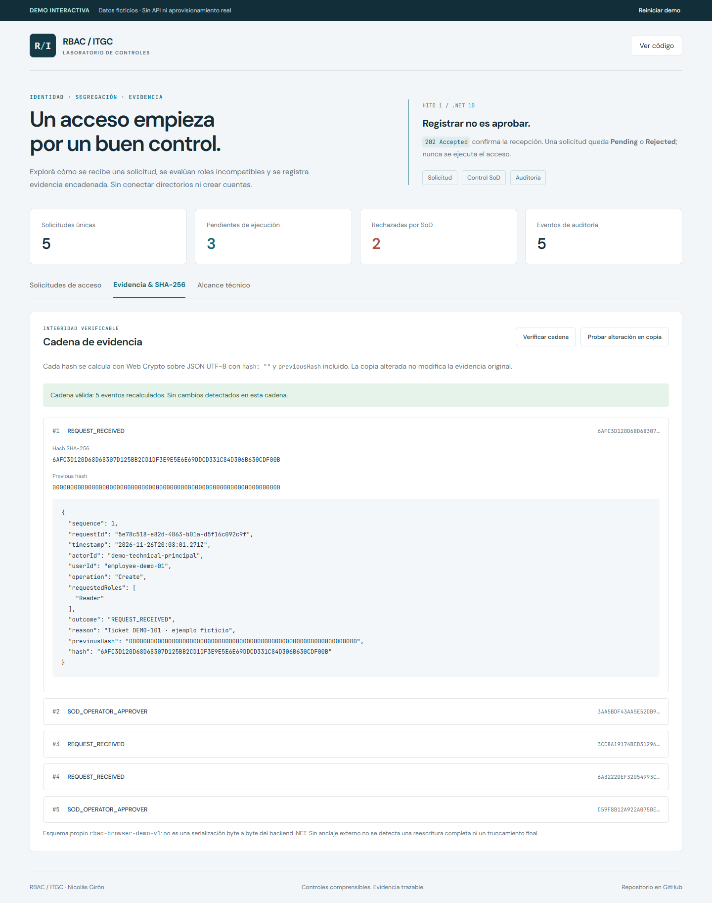

# Hito 1 — recepción de solicitudes y auditoría, .NET 10

## Demo interactiva

[Vista previa de la demo (acceso privado del propietario)](https://rbac-itgc-demo.nicogiron09.chatgpt.site) · [Ejecutar localmente y conocer los límites](demo/README.md)

Explorá solicitudes, conflictos SoD, reintentos idempotentes y evidencia SHA-256 con datos ficticios. Es una simulación en el navegador, independiente de la API: no autentica identidades ni aprovisiona cuentas.

## Capturas de la demo





## Backend .NET

Solución compilable con Domain → Application → Api. El adaptador en memoria está en Api/Storage para no añadir un cuarto proyecto al MVP. Domain no depende de ASP.NET Core. No hay paquetes NuGet externos.

En el espacio de trabajo recibido solo se encontró el prototipo anterior Rbac.Core; las implementaciones aquí incluidas de SystemRole, SodPolicyValidator y ProvisioningRequest son referencias completas. Al integrar con tus proyectos, conservar una sola definición de cada tipo y ajustar las firmas del handler y del almacén a las existentes.

## Archivos principales

- Domain/AuditEvent.cs: entidad sellada con propiedades de solo lectura, colecciones ImmutableArray, JSON UTF-8 determinista para el esquema y cálculo SHA-256.
- Domain/ProvisioningRequest.cs: entidad inmutable, estados y enumeraciones de referencia.
- Domain/SodPolicyValidator.cs: reglas Operator/Approver y Administrator/Auditor.
- Application/SubmitRequest.cs: contrato, validación, handler y puerto de persistencia.
- Api/Storage/InMemoryProvisioningStore.cs: registro atómico, cadena e idempotencia.
- Api/Security/ApiKeyOptions.cs y ApiKeyMiddleware.cs: configuración validada al arrancar y autenticación antes del binding JSON.
- Api/Program.cs: DI, serialización y endpoints.

Ver [CODE.md](CODE.md) para el contenido completo de todos los archivos de implementación en un único documento.

## Configuración y ejecución

Requiere SDK .NET 10. Desde la raíz del proyecto, PowerShell:

```powershell
Copy-Item Api/appsettings.Example.json Api/appsettings.json
$env:ApiKey__Key = [Convert]::ToHexString([Security.Cryptography.RandomNumberGenerator]::GetBytes(32))
dotnet build RbacItgc.slnx
dotnet run --no-build --project Api --urls http://127.0.0.1:5080
```

El host carga appsettings.json automáticamente; BindConfiguration("ApiKey") utiliza la configuración combinada. ActorId sale del JSON; la clave de este ejemplo sale del entorno y sobrescribe el valor vacío del JSON. Para cargar también la clave desde appsettings.json, reemplazar Key con una clave aleatoria local y quitar la variable de entorno; el archivo está excluido de Git. JSON no cifra secretos: nunca publicar el archivo real ni registrar la cabecera. El ejemplo versionable no contiene credenciales. Opcionalmente usar User Secrets durante desarrollo.

La configuración inválida detiene el arranque; no existe clave por defecto. Las opciones se toman al iniciar: un cambio de credencial exige reiniciar. Una clave representa un principal técnico configurado mediante ActorId, no una identidad humana verificable. El middleware protege todos los endpoints y rechaza cabeceras ausentes, vacías, múltiples o inválidas con 401. Compara hashes de tamaño fijo mediante FixedTimeEquals.

## Ejemplo HTTP

```http
POST http://127.0.0.1:5080/api/v1/requests
X-Api-Key: <clave local>
Content-Type: application/json

{
  "externalId": "hr-2026-0001",
  "userId": "employee-001",
  "operation": "Create",
  "roles": ["Operator"],
  "expectedVersion": 0,
  "reason": "Ticket IAM-1001"
}
```

Devuelve 202 y Location: /api/v1/requests/{id}. GET de esa ruta devuelve la solicitud almacenada, o 404 si no existe. Operator junto con Approver, o Administrator junto con Auditor, produce 202 con Status Rejected y su RejectionCode. El rechazo se conserva y se audita; 202 expresa aceptación del registro de la solicitud, no aprobación del acceso.

Campos faltantes, roles desconocidos, enumeraciones numéricas, valores nulos o inválidos y campos extra → 400. La baja requiere roles vacíos. POST válido repetido con igual externalId y contenido normalizado devuelve el mismo ID y no agrega auditoría; cambiar el emisor o el contenido devuelve 409. El orden o duplicación de roles no altera la identidad de la solicitud. No se recortan ni cambian mayúsculas de identificadores.

## Atomicidad y concurrencia

ConcurrentDictionary hace atómica una operación sobre una clave; no hace atómica la actualización coordinada de una solicitud y una cadena global de auditoría. Aquí se usa System.Threading.Lock y un estado que contiene tres colecciones inmutables: solicitudes, índice externalId e historial. Bajo el mismo bloqueo se comprueba idempotencia, obtiene PreviousHash, crea el evento y construye el siguiente estado. Volatile.Write publica una única referencia únicamente cuando todo está listo. Las lecturas toman un snapshot con Volatile.Read y no pueden modificar sus entidades. Si construir un evento falla, no se publica un estado parcial.

Las garantías son para un único proceso y una sola instancia singleton del almacén. El crecimiento de memoria no está limitado en esta demostración. Al reiniciar se pierde todo. No hay persistencia ni coordinación distribuida.

## Formato del hash y evidencia

Se respeta la regla del ARCHITECTURE.md previo: Hash = HEX_UPPER(SHA256(JSON_UTF8(evento con Hash vacío y PreviousHash incluido))). El enlace con el evento anterior está dentro del JSON; no se agrega un segundo prefijo externo PreviousHash + JSON, porque eso sería otro formato de cálculo. GetHashPayloadUtf8 devuelve exactamente los bytes usados y CalculateHash permite recalcularlo.

El orden de propiedades se fija en la proyección explícita del método; enum strings, sin indentación y UTC. El campo Hash debe quedar vacío durante el cálculo para evitar una autorreferencia. El evento incluye RequestedRoles; Before y After quedan null porque la recepción no leyó ni modificó cuentas. No se inventa un estado anterior o posterior a partir del payload.

El esquema de estos eventos de recepción difiere del AuditEntry del prototipo .NET 8: no mezclar sus cadenas ni esperar hashes idénticos entre esquemas. Para interoperabilidad general se deberá congelar/versionar una serialización canónica; las comprobaciones actuales cubren este esquema .NET y una muestra independiente en Python.

AuditEvent es inmutable mediante sus APIs públicas normales: sealed, sin setters ni init, strings y valores, colecciones inmutables y ninguna referencia mutable de entrada expuesta. Esto no convierte el almacenamiento en un registro inmutable ante un administrador del proceso. Una cadena sin anclaje externo no detecta una reescritura completa ni un truncamiento final. WORM, separación de permisos y anclaje firmado permanecen pendientes.

## Alcance exacto de este requerimiento

Este corte registra Pending o Rejected; no ejecuta aprovisionamiento. ExpectedVersion se valida como entero no negativo y se conserva: la comprobación de versión real y de existencia de cuenta corresponde al Worker antes de ejecutar Create/ReplaceRoles/Disable. ReplaceRoles define el conjunto final completo que se valida por SoD. No hay reactivación de cuentas ni estado Succeeded en este corte. El archivo anterior describe la arquitectura objetivo; no se presenta como implementada aquí.

## Verificación

```powershell
dotnet build RbacItgc.slnx
dotnet run --no-build --project Tests
python Tests/smoke.py
```

Verificado el 2026-11-04 con SDK 10.0.402 y runtime 10.0.13: cero errores/advertencias, 19 comprobaciones de dominio/aplicación/almacén, y prueba HTTP real. Esta última incluye solicitudes concurrentes con claves iguales y diferentes; 63 eventos conservan secuencia continua y sus hashes se recalculan independientemente desde Python. El script termina el proceso de API al finalizar. La restauración de este entorno usó una fuente local y NuGetAudit=false solo como argumento de la ejecución; no se alteró la configuración de auditoría del proyecto.

## Referencias

- [Configuración ASP.NET Core 10](https://learn.microsoft.com/en-us/aspnet/core/fundamentals/configuration/?view=aspnetcore-10.0).
- [Minimal APIs ASP.NET Core 10](https://learn.microsoft.com/en-us/aspnet/core/fundamentals/minimal-apis?view=aspnetcore-10.0).
